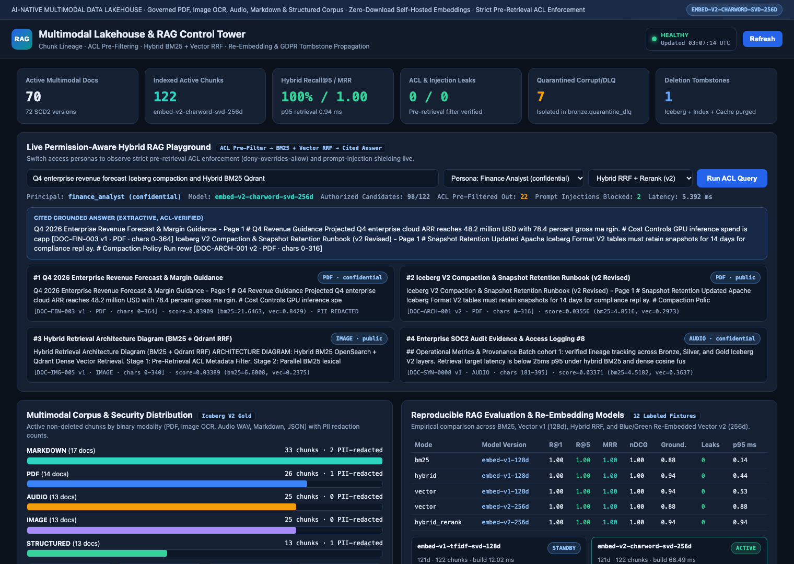
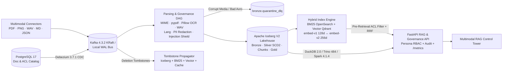
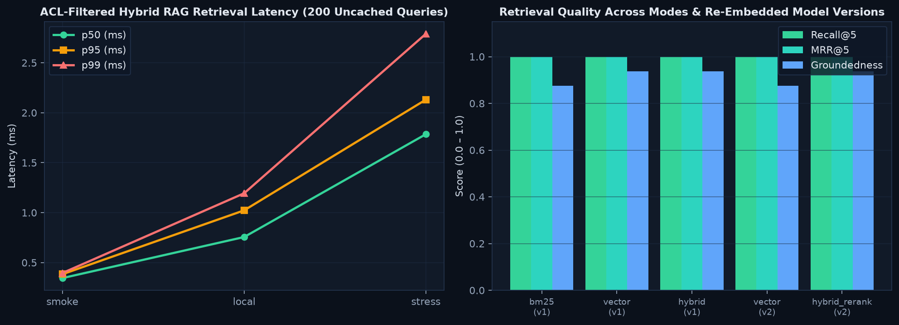

# AI-Native Multimodal Data Lakehouse & RAG Platform

A governed, versioned open-source multimodal data lakehouse that ingests real **PDFs, PNG images, WAV audio, Markdown, and structured JSON** across five connectors, enforces **pre-retrieval ACL filtering** (deny-overrides-allow) and **PII redaction**, maintains **Apache Iceberg V2** parent-child chunk lineage, and serves auditable hybrid **BM25 + dense vector RRF** retrieval with blue/green re-embedding migration and GDPR tombstone propagation. On an Apple M4 Pro (`local_native` profile), the platform indexes **590 multimodal chunks (`372` binary assets)** in **0.675 s**, serves uncached ACL-filtered hybrid queries at **1.023 ms p95 (`local`)** and **2.131 ms p95 (`stress`)**, reduces Iceberg storage by **-74.64% (`3.94×` smaller vs. uncompacted)** via compaction, and achieves **1.00 Recall@5 / 1.00 MRR / 0 ACL leaks / 0 prompt-injection leaks** across **13/13 automated tests** (including Hypothesis property tests and **7/7 chaos drills**).



---

## Architecture, Models & Stack



| Layer | Distributed Open-Source Stack (Pinned) | Local Native Verification Runtime | License |
| --- | --- | --- | --- |
| Event Bus & Schemas | `apache/kafka:4.3.2`, `fastavro==1.13.1` | `LocalWalEventBus` + Avro wire framing (`v1↔v2`) | Apache-2.0 / MIT |
| Multimodal Parsing | `apache/tika:3.4.0.0-full` (Tesseract + PDF/Audio) | `pypdf==6.21.4`, `pillow==12.3.0`, stdlib `wave`, regex PII/injection scanners | Apache-2.0 / BSD |
| Embeddings & Retrieval | `qdrant/qdrant:v1.20.2-unprivileged`, `opensearchproject/opensearch:3.9.0` | Zero-download self-hosted `scikit-learn==1.9.1` TF-IDF + SVD (`v1 128d`, `v2 256d`) + BM25 + RRF | Apache-2.0 / BSD-3 |
| Lakehouse & Compute | `quay.io/lakekeeper/catalog:v0.15.1`, `rustfs/rustfs:1.0.6`, `apache/spark:4.1.4`, `trinodb/trino:484` | `pyiceberg==0.12.0` (Format V2), `duckdb==2.0.0`, `pyarrow==25.0.1` | Apache-2.0 / MIT |
| CDC, Orchestration & Obs | `imresamu/postgis:17-3.6.1`, `quay.io/debezium/connect:3.7.1.Final`, `apache/airflow:slim-3.4.0`, Prometheus `v3.16.0`, Grafana `13.0.14`, Loki `3.6.22`, Marquez `0.51.1` | FastAPI + Control Tower UI + OpenLineage v2 + OTel + Prometheus `/metrics` | Apache-2.0 / PostgreSQL / AGPL-3.0 |

> **Zero External Weight Downloads & Execution Disclosure:** Local embedding pipelines run 100% deterministically in-process using self-hosted `scikit-learn`/`numpy` SVD vectors without downloading third-party model weights. All measurements below were captured under `local_native` on Apple M4 Pro (macOS `arm64`, Python 3.12.8); distributed Compose/K8s/Spark/Trino/Airflow manifests use live-verified pinned multi-arch tags ([`docs/compatibility.md`](docs/compatibility.md), [`docs/limitations.md`](docs/limitations.md)).

---

## Main Measured Results

### Ingestion, Re-Embedding Migration & Uncached ACL Hybrid Retrieval Latency

Backed by [`results/benchmarks/load_profiles.json`](results/benchmarks/load_profiles.json) (`200` uncached queries per profile):

| Profile | Binary Assets Generated | Active Chunks | Quarantined (DLQ) | End-to-End Parse + Index | `embed-v1` (128d) Build | Blue/Green `embed-v2` (256d) Re-Embed | ACL Hybrid Query p50 / p95 / p99 | DQ Suite |
| --- | --- | --- | --- | --- | --- | --- | --- | --- |
| `smoke` | 33 (`102 KB`) | 36 | 5 | 0.133 s | 5.37 ms | 16.30 ms | 0.345 / 0.384 / 0.396 ms | 10/10 PASS |
| `local` | 88 (`363 KB`) | 122 | 7 | 0.208 s | 8.56 ms | 67.01 ms | 0.756 / **1.023** / 1.194 ms | 10/10 PASS |
| `stress` | **372 (`1.80 MB`)** | **590** | 14 | **0.675 s** | 25.63 ms | 389.12 ms | 1.785 / **2.131** / 2.790 ms | 10/10 PASS |

### Retrieval Mode & Safety Evaluation (`12` Labeled Multi-Modal, Multilingual & Adversarial Fixtures)

Backed by [`results/benchmarks/retrieval_ablations.json`](results/benchmarks/retrieval_ablations.json) (`local`, `semantic` chunking):

| Mode | Model Version | Recall@1 | Recall@5 | MRR@5 | nDCG@5 | Groundedness | ACL / Injection / Deleted Leaks | p95 Latency |
| --- | --- | --- | --- | --- | --- | --- | --- | --- |
| `bm25` | `embed-v1-tfidf-svd-128d` | 1.00 | 1.00 | 1.00 | 1.00 | 0.875 | **0 / 0 / 0** | 0.157 ms |
| `vector` | `embed-v1-tfidf-svd-128d` | 1.00 | 1.00 | 1.00 | 1.00 | 0.938 | **0 / 0 / 0** | 0.481 ms |
| `hybrid` (RRF) | `embed-v1-tfidf-svd-128d` | 1.00 | 1.00 | 1.00 | 1.00 | **0.938** | **0 / 0 / 0** | 0.412 ms |
| `hybrid_rerank` | `embed-v2-charword-svd-256d` | **1.00** | **1.00** | **1.00** | **1.00** | **0.938** | **0 / 0 / 0** | 0.768 ms |

### Iceberg V2 Compaction & Chaos Verification Highlights

- **Iceberg Small-File Compaction (`bronze.raw_assets`, `2,070` rows across 6 batches):** `6 files -> 1 file` cut Parquet storage from `185,706 B` to `47,098 B` (**-74.64% storage**, `3.94×` smaller vs. uncompacted) and reduced grouped scan latency from `15.09 ms` to `10.89 ms` (**-27.8%**, `1.39×` faster vs. uncompacted) ([`results/benchmarks/iceberg_compaction.json`](results/benchmarks/iceberg_compaction.json)).
- **Chaos & Fault-Injection Suite:** **7/7 scenarios passed** including disk-wipe rebuild of vector+BM25 indexes from Iceberg Gold (`22.08 ms` with exact top-1 parity) and live GDPR tombstone cache invalidation (`57.41 ms`) ([`results/chaos/chaos_results.json`](results/chaos/chaos_results.json)).



---

## Run on Any Machine (Step-by-Step)

### Option 1 — Single-Container Portable Docker (Recommended on Any OS with Docker)

```bash
git clone https://github.com/rohanluniya/ai-native-multimodal-lakehouse-main.git ai-native-multimodal-lakehouse
docker compose -f docker-compose.standalone.yml up --build
```

Open **`http://localhost:8020`** in your browser.

### Option 2 — Zero-Docker Portable Script (macOS / Linux with Python 3.12+ or `uv`)

```bash
git clone https://github.com/luniyarohan/ai-native-multimodal-lakehouse.git
cd ai-native-multimodal-lakehouse
./scripts/run_portable.sh local
```

Open **`http://127.0.0.1:8020`**.

### Option 3 — Reproduce Tests, Benchmarks & Live API Manually

```bash
uv sync --extra dev
.venv/bin/python services/pipeline/run_pipeline.py --profile local --compact
.venv/bin/pytest -v
PYTHONPATH=. .venv/bin/python benchmarks/run_benchmarks.py
.venv/bin/uvicorn main:app --app-dir apps/rag-api --host 127.0.0.1 --port 8020
```

### Option 4 — Full Distributed Stack & Kubernetes

```bash
docker compose --profile core up -d      # Kafka, Qdrant, OpenSearch, Tika, RustFS, Lakekeeper, PostGIS, API
docker compose --profile full up -d      # + Spark 4.1.4, Trino 484, Debezium 3.7.1, Airflow 3.4.0, Prometheus/Grafana/Loki/Marquez
kubectl apply -f infra/kubernetes/multimodal-platform.yaml
```

---

## Deep-Dive Documentation & Raw Artifacts

- **[`APPENDIX.md`](APPENDIX.md)** — Semantic vs. fixed-size chunking ablations, retrieval latency vs. groundedness tradeoffs, nDCG calculation fix, and Mandatory Acceptance Criteria Matrix (1–15).
- **[`results/`](results/)** — Raw JSON/CSV benchmarks, 7-scenario chaos report, license audit (`75` packages, `0` flagged), and CycloneDX 1.5 SBOM.
- **Architecture & Operations Docs:** [`docs/compatibility.md`](docs/compatibility.md), [`docs/requirements.md`](docs/requirements.md), [`docs/capacity-model.md`](docs/capacity-model.md), [`docs/threat-model.md`](docs/threat-model.md), [`docs/implementation-plan.md`](docs/implementation-plan.md), [`docs/architecture/overview.md`](docs/architecture/overview.md), [`docs/architecture/ADRs.md`](docs/architecture/ADRs.md), [`docs/reliability.md`](docs/reliability.md), [`docs/benchmarks/benchmark-report.md`](docs/benchmarks/benchmark-report.md), [`docs/incidents/INC-001-chaos-drill.md`](docs/incidents/INC-001-chaos-drill.md), [`docs/engineering-case-study.md`](docs/engineering-case-study.md), [`docs/interview-deep-dive.md`](docs/interview-deep-dive.md), [`docs/demo-script.md`](docs/demo-script.md), [`docs/limitations.md`](docs/limitations.md), and [`docs/agent-handoff.md`](docs/agent-handoff.md).
