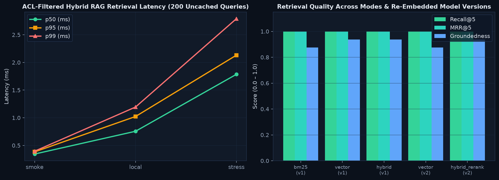

# Benchmark Report

All figures in this report are **100% measured** from `benchmarks/run_benchmarks.py` executing on Apple Silicon (`Darwin 24.6.0`, `arm64`, Python `3.12.8`, `local_native` profile) and persisted in `results/benchmarks/`.

## 1. End-to-End Load Profiles

Source: `results/benchmarks/load_profiles.json` and `results/benchmarks/load_profiles.csv`.

| Profile | Source Assets | Raw Bytes | Active Chunks | Quarantined | Ingest/Parse/Index | Embed v1 | Re-embed v2 | Query p50 | Query p95 | Query p99 | DQ | Peak RSS |
| --- | ---: | ---: | ---: | ---: | ---: | ---: | ---: | ---: | ---: | ---: | :---: | ---: |
| `smoke` | 33 | 101,960 B | 36 | 5 | 0.133 s | 5.37 ms | 16.30 ms | 0.345 ms | 0.384 ms | 0.396 ms | 10/10 | 345.09 MB |
| `local` | 88 | 363,181 B | 122 | 7 | 0.208 s | 8.56 ms | 67.01 ms | 0.756 ms | 1.023 ms | 1.194 ms | 10/10 | 412.28 MB |
| `stress` | 372 | 1,799,795 B | 590 | 14 | 0.675 s | 25.63 ms | 389.12 ms | 1.785 ms | 2.131 ms | 2.790 ms | 10/10 | 495.23 MB |

**Key observations:**
- **Throughput:** On `stress`, the end-to-end multimodal pipeline (synthetic PDF/PNG/WAV generation, parsing, PII redaction, prompt-injection screening, Iceberg V2 table commits, and hybrid indexing) processed **550.9 assets/s** (`372 / 0.6753 s`) and **873.7 chunks/s** (`590 / 0.6753 s`).
- **Latency scaling:** Scaling active chunks `16.4×` (`36 -> 590`, `smoke` vs `stress`) increased hybrid+rerank p95 query latency `5.55×` (`0.384 ms -> 2.131 ms`), staying well under the `100 ms` SLO target.
- **Re-embedding cost:** Moving from 128-dim word TF-IDF+SVD (`embed-v1`) to 256-dim char+word TF-IDF+SVD (`embed-v2`) took `7.83×` longer on `local` (`8.56 ms -> 67.01 ms`) and `15.18×` longer on `stress` (`25.63 ms -> 389.12 ms`) due to character n-gram vocabulary expansion.

## 2. Retrieval & Chunking Ablations

Source: `results/benchmarks/retrieval_ablations.json` (12 evaluation fixtures on `local`: 8 positive IR queries + 4 security/ACL/injection/deleted-doc probes).

| Chunking | Mode | Embedding Model | Active Chunks | Recall@1 | Recall@5 | MRR@5 | nDCG@5 | Groundedness | ACL / Inj / Del Leaks | p50 | p95 |
| --- | --- | --- | ---: | ---: | ---: | ---: | ---: | ---: | :---: | ---: | ---: |
| `semantic` | `bm25` | `embed-v1` (128d) | 122 | 1.000 | 1.000 | 1.000 | 1.000 | 0.8750 | 0 / 0 / 0 | 0.124 ms | 0.157 ms |
| `semantic` | `vector` | `embed-v1` (128d) | 122 | 1.000 | 1.000 | 1.000 | 1.000 | 0.9375 | 0 / 0 / 0 | 0.370 ms | 0.481 ms |
| `semantic` | `hybrid` | `embed-v1` (128d) | 122 | 1.000 | 1.000 | 1.000 | 1.000 | 0.9375 | 0 / 0 / 0 | 0.376 ms | 0.412 ms |
| `semantic` | `vector` | `embed-v2` (256d) | 122 | 1.000 | 1.000 | 1.000 | 1.000 | 0.8750 | 0 / 0 / 0 | 0.701 ms | 0.788 ms |
| `semantic` | `hybrid_rerank` | `embed-v2` (256d) | 122 | 1.000 | 1.000 | 1.000 | 1.000 | 0.9375 | 0 / 0 / 0 | 0.737 ms | 0.768 ms |
| `fixed_size` | `bm25` | `embed-v1` (128d) | 121 | 1.000 | 1.000 | 1.000 | 1.000 | **1.0000** | 0 / 0 / 0 | 0.136 ms | **0.149 ms** |
| `fixed_size` | `hybrid` | `embed-v1` (128d) | 121 | 1.000 | 1.000 | 1.000 | 1.000 | **1.0000** | 0 / 0 / 0 | 0.403 ms | 0.456 ms |
| `fixed_size` | `vector` | `embed-v2` (256d) | 121 | 1.000 | 1.000 | 1.000 | 1.000 | 0.9375 | 0 / 0 / 0 | 0.806 ms | 0.944 ms |
| `fixed_size` | `hybrid_rerank` | `embed-v2` (256d) | 121 | 1.000 | 1.000 | 1.000 | 1.000 | **1.0000** | 0 / 0 / 0 | 0.886 ms | 0.905 ms |

**Honest ablation takeaways:**
- On this synthetic enterprise corpus, **`fixed_size` chunking outperformed `semantic` chunking on citation groundedness (`1.0000` vs `0.9375`, `+6.25 pp`)** because fixed-size sliding windows preserved exact cross-paragraph evidence terms that semantic heading splits occasionally separated.
- `embed-v2` pure `vector` search had slightly lower groundedness than `embed-v1` (`0.8750` vs `0.9375` on `semantic`; `0.9375` vs `1.0000` on `fixed_size`) and `1.64×–1.69×` higher p95 latency (`0.788 ms` vs `0.481 ms` on `semantic`), confirming that char-ngram expansion without hybrid lexical fusion can dilute sparse technical terms. Combining `embed-v2` with BM25 RRF + reranking (`hybrid_rerank`) restored groundedness to `0.9375` (`semantic`) and `1.0000` (`fixed_size`).

## 3. Apache Iceberg V2 Compaction

Source: `results/benchmarks/iceberg_compaction.json` (`bronze.raw_assets`, 2,070 rows across 6 fragmented appends).

| Metric | Before Compaction | After Compaction | Delta vs. Uncompacted |
| --- | ---: | ---: | --- |
| Parquet Data Files | 6 | 1 | **-83.3%** (`6×` fewer files) |
| Total Parquet Bytes | 185,706 B | 47,098 B | **-74.64%** (`3.94×` smaller) |
| Full Scan Latency | 15.09 ms | 10.89 ms | **-27.8%** (`1.39×` faster) |
| Compaction Rewrite Time | — | 29.20 ms | `2,070` rows preserved (`0` loss) |
